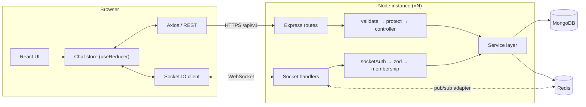

# Real-Time Chat

A full-stack messaging app built with **React, Node.js/Express, Socket.IO, MongoDB and Redis**. It supports direct and group chats with live typing indicators, online presence, read receipts, file sharing and notifications.

The project focuses on fundamentals done properly rather than a long feature list. It has a layered backend, validation at every boundary, one error format, authentication on both HTTP and WebSocket, cursor pagination, idempotent writes, horizontal scaling through Redis, and a client that stays consistent when the network misbehaves.

---

## Features

**Messaging**
- 1-to-1 and group conversations, delivered instantly over WebSockets
- Optimistic sending: messages appear immediately, are confirmed by a server acknowledgement, and can be retried if they fail
- Image and file attachments (Cloudinary) with an upload progress bar
- Edit and delete your own messages (soft delete)
- Message history with infinite scroll that doesn't jump when older pages load

**Real-time awareness**
- Typing indicators ("Alice is typing…", "Alice and Bob are typing…")
- Online/offline status with "last seen", correct across multiple tabs and devices
- Read receipts ("Seen", "Seen by Alice, Bob")
- Unread counters per conversation and in the browser tab title
- Toast notifications for messages in other conversations or while the tab is in the background
- Automatic catch-up after a dropped connection, so nothing sent while you were offline is missed

**Groups**
- Create groups and add or remove members (admins only), rename, leave
- Admin role kept per group; if the last admin leaves, the longest-standing member is promoted
- System messages such as "Alice added Bob"

**Accounts**
- Register and log in with JWT; the session survives page refreshes
- Profile: username, bio, avatar upload

---

## Tech stack

| Layer | Technology |
| --- | --- |
| Frontend | React 19, React Router 7, Tailwind CSS 4, Axios, Socket.IO client, Vite |
| Backend | Node.js, Express 5, Socket.IO 4 |
| Database | MongoDB with Mongoose |
| Cache / pub-sub | Redis (Socket.IO adapter, presence, rate limiting) |
| Files | Cloudinary (via Multer memory storage) |
| Validation | Zod (env, HTTP bodies/queries/params, socket payloads) |
| Security / ops | JWT, bcrypt, helmet, express-rate-limit, pino logging |

---

## Architecture



**Request flow**

```
HTTP:   route → validate(zod) → protect(JWT) → controller → service → model
Socket: event → socketAuth(JWT, at handshake) → zod → service → io.emit
```

Controllers and socket handlers are thin. **All business rules live in the service layer**, which both transports share. A message is validated, authorized and saved the same way whether it arrives over HTTP or WebSocket.

### Project structure

```
server/
├── config/        env (zod-validated), MongoDB, Redis, Cloudinary
├── models/        User, Conversation, Message
├── validators/    zod schemas for every input
├── middleware/    auth, validate, rate limiting, upload, errors, 404
├── services/      business logic (auth, conversations, messages, presence, uploads)
├── controllers/   HTTP ↔ service translation
├── routes/        REST endpoints under /api/v1
├── sockets/       Socket.IO bootstrap, auth middleware, event handlers
└── utils/         ApiError, logger, helpers

client/src/
├── context/       Auth, Socket and Chat providers + the chat reducer
├── hooks/         useAuth, useChat, useSocketEvent, useTyping, useDebounce, …
├── services/      Axios instance and one function per endpoint
├── components/    ui/ (primitives), chat/ (feature components), layout/
├── pages/         Login, Register, Chat, Profile, 404
├── routes/        ProtectedRoute, PublicRoute
└── utils/         formatting, validation rules, conversation helpers
```

---

## Design decisions & trade-offs

These are the choices worth explaining, and the reasons for them.

**1. One service layer for REST and WebSocket.** Text messages go over the socket (low latency, with an acknowledgement). Files go over HTTP (multipart with progress events). Both call `messageService`, so there is one place for membership checks, validation and persistence.

**2. The server decides which rooms a socket joins.** Clients never send a room name; letting them would let anyone listen to any conversation. On connect, a socket joins `user:<id>` and the `conv:<id>` rooms of conversations the database says it belongs to. When membership changes, the server calls `socketsJoin` / `socketsLeave`, so a removed member stops receiving events immediately.

**3. JWT in `localStorage` (deliberately simple).** The token is sent as a Bearer header on HTTP and in the socket handshake (`auth.token`). Both go through the same `authenticateToken()`, which also rejects tokens for deleted users.
*Trade-off:* `localStorage` can be read by any script that runs on the page, so an XSS bug would leak the token. React escapes all rendered text and the app never uses `dangerouslySetInnerHTML`, which limits that risk. The production-grade upgrade is a short-lived access token kept in memory plus a rotating refresh token in an `httpOnly; Secure; SameSite` cookie. That trades the XSS risk for CSRF handling.

**4. Cursor pagination, not `skip`/`limit`.** Messages are paged with `?before=<messageId>`, using the `{ conversation, _id }` index (ObjectIds are time-ordered). Offset pagination shifts while new messages arrive, which causes duplicates and gaps. A cursor stays stable. `?after=<id>` uses the same index to catch up after a reconnect.

**5. Idempotent sends.** Each message carries a client-generated `clientId`, and there's a unique index on `{ sender, clientId }`. If the server saves a message but the acknowledgement is lost, the client's retry returns the original message instead of creating a duplicate. The same id lets the sender swap its optimistic copy for the confirmed one.

**6. Horizontal scaling with Redis.** Socket.IO rooms exist only in one process's memory. The **Redis adapter** relays broadcasts between instances, so users connected to different servers still talk to each other. Rate-limit counters and presence also live in Redis, so they hold across instances.

**7. Presence that handles multiple tabs.** Presence is a Redis set of socket ids per user, updated with an atomic `MULTI` (add + count). A user is online while the set is non-empty, so closing one of two tabs doesn't mark them offline. If a server is hard-killed, its sockets never send `disconnect`. On connect and disconnect, the server asks every instance which sockets really exist (`fetchSockets`) and prunes dead ids. A heartbeat with TTLs would be the next step.

**8. One DM per pair, enforced by the database.** A direct conversation stores a sorted `directKey` ("idA_idB") with a unique index. If both users start a chat at the same moment, one insert fails with a duplicate-key error and the server returns the existing conversation. That race can't be solved by checking in application code first.

**9. Unread counts without a counter column.** Each participant has a `lastReadAt`. Unread = messages from others newer than that, computed for the whole sidebar in a single aggregation. Read receipts reuse the same field, so there's no per-message `readBy` array growing with every reader.

**10. Validation at every boundary.** Zod validates environment variables (the server won't boot with bad config), HTTP input and socket payloads. Because fields must be the declared type, payloads like `{ "email": { "$gt": "" } }` (NoSQL injection) are rejected. User search escapes regex input to prevent ReDoS.

**11. One error format.** Services throw `ApiError`s. The error middleware also maps Zod, Mongoose (validation, cast, duplicate key), JWT and Multer errors to proper status codes with the shape `{ message, details? }`. Express 5 forwards rejected promises to that middleware, so controllers have no try/catch. Socket handlers use `withAck()` to send the same error shape back in their acknowledgement.

**12. Client state with `useReducer`.** One pure reducer handles every chat state change, whether it comes from a REST response, an acknowledgement or a broadcast. Because the same message can arrive more than once (ack plus broadcast, or backfill), every transition is idempotent.

**13. Reliability details.**
- Messages aren't buffered while offline. Sends fail fast with a retry button rather than going out minutes later.
- A missed `typing:stop` expires on its own after 5 s.
- Typing events are throttled and debounced.
- User search aborts stale requests (`AbortController`).
- Read receipts are only sent while the tab is visible.
- The server shuts down gracefully, and exits with a clear message if env vars are missing.

---

## REST API

Base URL: `/api/v1`. Every endpoint except register, login and health requires `Authorization: Bearer <token>`.

| Method | Endpoint | Description |
| --- | --- | --- |
| POST | `/auth/register` | Create an account (rate limited) |
| POST | `/auth/login` | Log in with email or username (rate limited) |
| GET | `/auth/me` | Current user |
| GET | `/users?q=` | Search users by username prefix |
| PATCH | `/users/me` | Update username / bio |
| PATCH | `/users/me/avatar` | Upload avatar (multipart `avatar`, ≤ 2 MB image) |
| GET | `/conversations` | Your conversations with last message and unread count |
| POST | `/conversations/direct` | `{ userId }`: find or create a DM |
| POST | `/conversations/group` | `{ name, memberIds }`: create a group (you become admin) |
| GET | `/conversations/:id` | One conversation (members only) |
| PATCH | `/conversations/:id` | `{ name }`: rename a group (admins) |
| POST | `/conversations/:id/members` | `{ userIds }`: add members (admins) |
| DELETE | `/conversations/:id/members/:userId` | Remove a member (admins) or leave (yourself) |
| GET | `/conversations/:id/messages?before=&after=&limit=` | Cursor-paginated history |
| POST | `/conversations/:id/messages/attachment` | Send a file (multipart `file` ≤ 10 MB, optional `content`) |
| PATCH | `/messages/:id` | `{ content }`: edit your message |
| DELETE | `/messages/:id` | Delete your message (soft delete) |
| GET | `/health` | MongoDB and Redis status |

Errors always look like `{ "message": "...", "details": [{ "field": "...", "message": "..." }] }`.

## Socket events

The connection authenticates with `io({ auth: { token } })`. A rejected handshake returns `connect_error` with the message `UNAUTHORIZED`.

| Direction | Event | Payload |
| --- | --- | --- |
| client → server | `message:send` | `{ conversationId, content, clientId }`, ack `{ ok, message }` or `{ ok: false, error }` |
| client → server | `conversation:read` | `{ conversationId }`, with ack |
| client → server | `typing:start` / `typing:stop` | `{ conversationId }` |
| server → client | `message:new` | message |
| server → client | `message:updated` / `message:deleted` | message |
| server → client | `conversation:new` / `conversation:updated` | conversation |
| server → client | `conversation:removed` | `{ conversationId }` |
| server → client | `conversation:read` | `{ conversationId, userId, readAt }` |
| server → client | `typing:start` / `typing:stop` | `{ conversationId, userId, username }` |
| server → client | `presence:snapshot` | `{ onlineUserIds }` (on connect) |
| server → client | `presence:update` | `{ userId, online, lastSeen? }` |

---

## Getting started

### Prerequisites
- Node.js 20+
- A MongoDB database ([MongoDB Atlas](https://www.mongodb.com/atlas) free tier works)
- A Redis instance ([Redis Cloud](https://redis.io/cloud/) or [Upstash](https://upstash.com/) free tier, or a local Redis/Memurai)
- A [Cloudinary](https://cloudinary.com/) account (free tier)

> **Quick start:** only `MONGO_URI` and `JWT_SECRET` are required in development. Without `REDIS_URL` the server uses in-memory stores (one instance only); without Cloudinary keys, uploads are disabled. Both are required when `NODE_ENV=production`.

### Setup

```bash
git clone https://github.com/05kartikey/real-time-chat.git
cd real-time-chat
npm run install:all          # installs root, server and client dependencies

cp .env.example .env         # then fill in the values
```

The server validates `.env` at startup and lists anything missing or invalid. Generate a JWT secret (32+ characters) with:

```bash
node -e "console.log(require('crypto').randomBytes(48).toString('hex'))"
```

> Cloudinary note: free accounts block delivery of PDF/ZIP files by default. Enable *Settings → Security → Allow delivery of PDF and ZIP files* if you want to share them.

### Run

```bash
npm run dev
```

- Client: http://localhost:5173 (Vite proxies `/api` and `/socket.io` to the server)
- Server: http://localhost:5000 (`GET /api/v1/health` to check)

To see real-time features, open the app in two browsers (or a normal and a private window) and log in as two different users.

### Try horizontal scaling

Start a second server instance on another port, pointed at the same MongoDB and Redis:

```bash
cd server && PORT=5001 node server.js
```

Connect one user through each instance. Messages, typing indicators and presence still flow between them through the Redis adapter.

---

## What I'd add next

- Automated tests: API integration tests (Jest + Supertest + mongodb-memory-server) and socket tests
- Refresh-token rotation in httpOnly cookies (see trade-off #3)
- Docker Compose (app + MongoDB + Redis) and an Nginx reverse proxy with WebSocket upgrade
- CI pipeline running lint and tests on every pull request
- Presence heartbeats with TTLs, and delivery receipts in addition to read receipts
